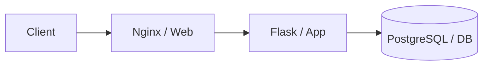

# Praktikum Bab 1–3 — Fondasi DevSecOps, Docker, dan Docker Compose

**Mata kuliah:** Workshop DevOps  
**Penyusun:** Kelompok 2 — D4 Lanjut Jenjang Teknik Informatika, PENS (2026)

[Lihat laporan lengkap (PDF)](Laporan.pdf) · [Kembali ke daftar laporan](../README.md)

## Gambaran umum

Praktikum Bab 1–3 memperkenalkan persiapan lingkungan DevSecOps, instalasi dan penggunaan Docker, serta pengelolaan network, storage, dan beberapa service melalui Docker Compose. Pengujian dilakukan pada **VM Ubuntu 22.04 LTS di Proxmox VE**. Laporan juga memuat evidence hasil perintah dan pengujian web melalui browser.

## Bab 1 — Fondasi teoretis dan kerangka kerja DevSecOps

**Fokus:** menyiapkan baseline lingkungan dan mengenali risiko keamanan sebelum menjalankan layanan.

- Membuat direktori kerja `~/devsecops-lab/` untuk memisahkan aplikasi, laporan, SBOM, kebijakan, dan berkas sensitif.
- Memeriksa versi Docker, akses Docker daemon, serta kesiapan plugin Compose.
- Menguji isolasi web root agar direktori sensitif seperti `keys/`, `reports/`, dan `sbom/` tidak dapat diakses melalui layanan web.
- Memeriksa opsi keamanan host kernel dan menyusun *threat statement* mengenai kesalahan pemetaan volume atau kebocoran berkas internal.

**Hasil:** laporan mencatat verifikasi akses Docker, pengujian isolasi web root, dan pemeriksaan konfigurasi keamanan sebagai evidence baseline.

## Bab 2 — Konsep container dan instalasi Docker

**Fokus:** menginstal Docker Engine dan menguji deployment web server dalam container.

1. Menyiapkan dependensi dan repository resmi Docker menggunakan GPG keyring.
2. Mengatur penggunaan Docker oleh user non-root, kemudian memeriksa Docker Engine dan CLI.
3. Menjalankan container Nginx dan menguji respons HTTP menggunakan `curl` serta browser.
4. Menjalankan container interaktif untuk mengeksplorasi lingkungan container.
5. Membuat image web sederhana melalui Dockerfile, lalu menguji custom web server pada port host yang ditentukan.

**Hasil:** Nginx dapat diakses dari browser; image kustom berhasil dibangun dan dijalankan. Laporan juga membahas perbedaan `EXPOSE` pada image dengan publikasi port menggunakan opsi `-p` saat container berjalan.

## Bab 3 — Docker network, volume, dan Compose

**Fokus:** komunikasi antarkontainer serta perbedaan karakteristik penyimpanan.

| Komponen yang diuji | Temuan pada praktikum |
|---|---|
| User-defined bridge network | Container pada network yang sama dapat berkomunikasi menggunakan nama container melalui DNS Docker. |
| Named volume | Data tetap tersedia setelah container yang menggunakan volume dihapus, selama volumenya tidak ikut dihapus. |
| Bind mount | Perubahan berkas HTML pada host langsung terlihat melalui Nginx tanpa perlu rebuild image. |
| `tmpfs` | Berkas sementara pada mount `tmpfs` tidak bertahan setelah container direstart. |
| Docker Compose | Stack Nginx–Flask–PostgreSQL dapat dijalankan, dan pemeriksaan healthcheck menunjukkan database berstatus `healthy`. |

### Gambaran stack multi-container

Diagram di atas menggambarkan hubungan logis tiga service pada latihan Compose; pengaturan jaringan dan port yang tepat dijelaskan pada PDF.

## Kesimpulan

Praktikum membuktikan dasar penggunaan Docker untuk menjalankan aplikasi terisolasi, menghubungkan service melalui network yang terdefinisi, dan memilih storage sesuai kebutuhan persistensi. Penggunaan Compose membantu mengelola stack multi-container, sedangkan verifikasi terminal dan HTTP digunakan sebagai evidence bahwa konfigurasi berjalan sesuai skenario.

## Laporan dan referensi

- [Laporan praktikum Bab I, II, dan III (PDF)](Laporan.pdf)
- [Materi DevSecOps](https://github.com/ferryas-pens/devsecops)

> **Catatan:** README ini adalah ringkasan laporan, bukan pengganti berkas Dockerfile, Compose, atau file praktikum yang ditampilkan dalam PDF.
