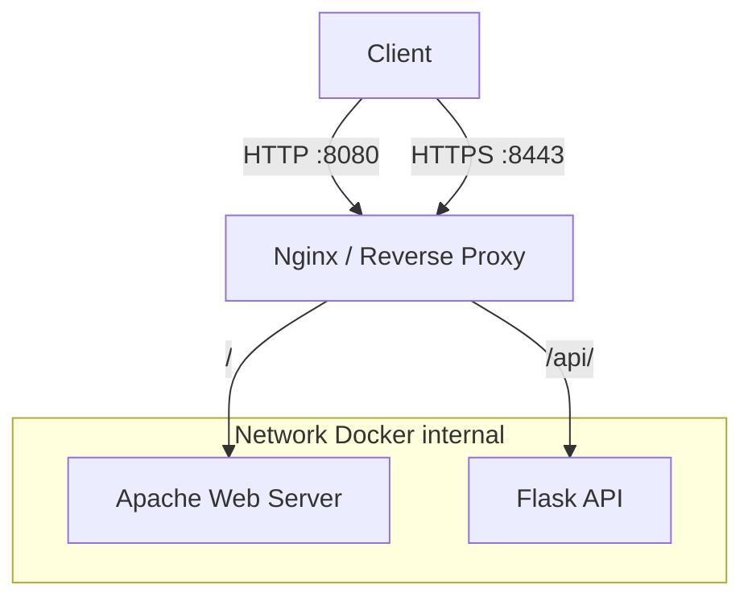

# Praktikum Bab 4 — Nginx, Apache, Flask, dan TLS dengan Docker Compose

**Mata kuliah:** Workshop DevOps  
**Penyusun:** Kelompok 2 — D4 Lanjut Jenjang Teknik Informatika, PENS (2026)

[Lihat laporan lengkap (PDF)](Laporan.pdf) · [Kembali ke daftar laporan](../README.md)

## Gambaran umum

Bab 4 membahas penggunaan **Nginx sebagai reverse proxy** di depan layanan Apache dan Flask. Nginx menjadi titik masuk request, melakukan redirect HTTP ke HTTPS, menangani sertifikat TLS laboratorium, dan meneruskan request ke service internal berdasarkan path. Seluruh service dijalankan melalui Docker Compose.

## Topologi layanan

Alamat host pada konfigurasi laporan menggunakan binding `127.0.0.1`, sehingga pengujian port ditujukan pada akses lokal host. **Hanya Nginx yang memublikasikan port host**; Apache dan Flask berkomunikasi melalui network Docker internal. Koneksi dari Nginx ke service internal pada skenario ini menggunakan HTTP, sedangkan TLS diterminasi di Nginx.

## Alur praktikum

1. Membuat struktur direktori terpisah untuk konfigurasi Nginx, situs Apache, source Flask, sertifikat, dan log.
2. Membuat sertifikat **self-signed** untuk pengujian HTTPS lokal, bukan sertifikat tepercaya untuk produksi.
3. Menyusun `compose.yaml` untuk service `proxy`, `apache-web`, dan `flask-app` beserta healthcheck Flask.
4. Mengatur Nginx agar request HTTP diarahkan ke HTTPS, path `/` menuju Apache, dan path `/api/` menuju Flask.
5. Mengatur *security headers* dan forwarded headers, termasuk informasi skema koneksi yang diteruskan kepada backend.
6. Memvalidasi konfigurasi, menjalankan stack, lalu menguji endpoint, TLS, published port, dan access log.

## Ringkasan hasil pengujian

| Pemeriksaan | Hasil dalam laporan |
|---|---|
| `docker compose config` | Valid |
| Kesehatan Flask | `healthy` |
| Redirect `http://localhost:8080/` | HTTP `301` menuju `https://localhost:8443/` |
| Halaman Apache melalui HTTPS | HTTP `200 OK` |
| Endpoint `/api/` | Request diteruskan ke Flask dan menghasilkan respons JSON |
| TLS | Koneksi berhasil menggunakan sertifikat self-signed laboratorium |
| Isolasi port | Apache dan Flask tidak memiliki published port host |
| Access log Nginx | Request yang diuji tercatat |

## Konsep yang dipelajari

- **Reverse proxy:** memusatkan routing, pencatatan, dan kebijakan keamanan di lapisan depan.
- **TLS termination:** koneksi HTTPS dari client ditangani oleh Nginx; sertifikat laboratorium tidak otomatis dipercaya browser.
- **Trusted forwarding headers:** backend memperoleh informasi tentang request asal melalui proxy, tetapi header tersebut harus dipercaya hanya dari proxy yang sah.
- **Configuration as code:** konfigurasi diuji melalui syntax/lint dan pengujian integrasi sebelum diterapkan; alur tersebut terpisah dari lalu lintas request client.

## Kesimpulan

Pengujian pada laporan menunjukkan Nginx dapat menyediakan akses HTTP/HTTPS sekaligus meneruskan request ke Apache dan Flask melalui network internal. Pemisahan published port dan validasi TLS memperjelas peran reverse proxy sebagai batas akses layanan.

## Laporan dan referensi

- [Laporan praktikum Bab IV (PDF)](Laporan.pdf)
- [Materi DevSecOps](https://github.com/ferryas-pens/devsecops)

> **Catatan:** contoh ini untuk laboratorium; key dan sertifikat privat tidak disertakan dalam repository.
