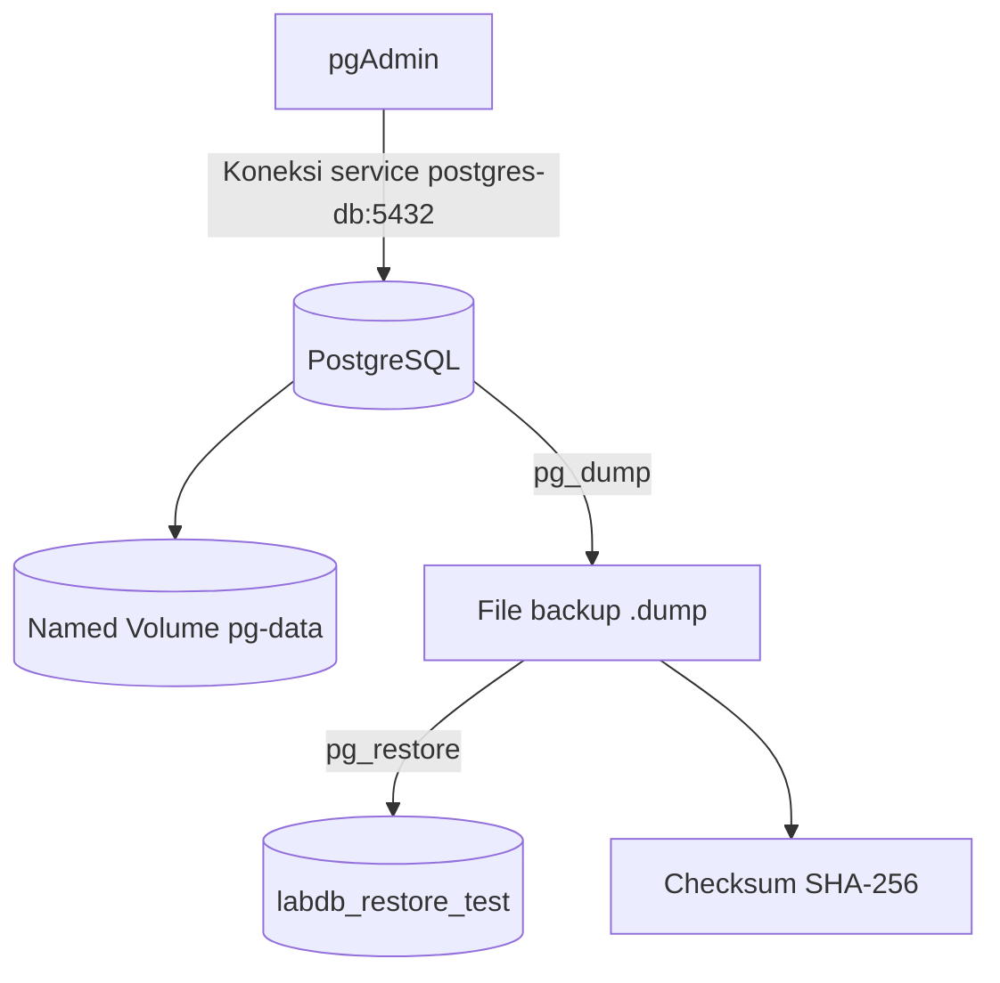

# Praktikum Bab 5 — PostgreSQL, pgAdmin, Volume, Backup, dan Restore

**Mata kuliah:** Workshop DevOps  
**Penyusun:** Kelompok 2 — D4 Lanjut Jenjang Teknik Informatika, PENS (2026)

[Lihat laporan lengkap (PDF)](Laporan.pdf) · [Kembali ke daftar laporan](../README.md)

## Gambaran umum

Praktikum ini menjalankan **PostgreSQL 16-alpine** dan **pgAdmin** melalui Docker Compose, menyimpan data menggunakan named volume, dan menguji apakah data dapat dipulihkan dari backup. Laporan juga membahas pembatasan kredensial menggunakan file `.env` dan pendekatan Docker Compose secrets.

## Rancangan layanan

Pada diagram, alur `pg_dump`/`pg_restore` menunjukkan proses backup dan restore yang dilakukan lewat skrip praktikum; file backup tidak otomatis dibuat oleh PostgreSQL.

## Tahapan praktikum

1. Membuat direktori `backup/`, `init/`, `pgadmin/`, dan `scripts/` serta menyiapkan contoh konfigurasi `.env.example`.
2. Membuat `compose.yaml` dengan service `postgres-db` dan `pgadmin`, network internal, named volume `pg-data`, serta healthcheck `pg_isready`.
3. Menyiapkan tabel `students` dan data awal melalui SQL inisialisasi; pgAdmin dikonfigurasi untuk mengakses database melalui nama service.
4. Menjalankan Compose dan memeriksa status database serta isi tabel.
5. Menguji persistensi data setelah `docker compose down` lalu `docker compose up -d`.
6. Menjalankan backup menggunakan `pg_dump`, membuat checksum `.sha256`, lalu menguji restore ke database terpisah `labdb_restore_test`.
7. Menguji pendekatan penyimpanan password PostgreSQL dalam file secret yang dibaca dari `/run/secrets/postgres_password`.

## Hasil pengujian

| Pengujian | Hasil yang tercatat |
|---|---|
| Docker Compose dan status PostgreSQL | Konfigurasi dapat diproses dan PostgreSQL `healthy` |
| Schema dan data awal | Tabel `students` tersedia; sesudah penambahan data berisi **3 record** |
| Persistensi | Ketiga record tetap ada setelah stack dihentikan dan dijalankan kembali |
| Backup | File `.dump` berhasil dibuat dan berukuran lebih dari nol |
| Integritas backup | Pemeriksaan checksum SHA-256 menghasilkan `OK` |
| Restore | Database `labdb_restore_test` berisi **3 record** yang sesuai dengan database sumber |
| Docker Secret | Password terpisah dari nilai langsung di `compose.yaml` dan tersedia melalui mount secret pada container |

## Catatan batasan verifikasi

Laporan mencatat percobaan pemeriksaan apakah file `.env` dan backup telah diabaikan Git. Namun, saat pengujian tersebut direktori **belum dikenali sebagai repository Git**; karena itu hasilnya **belum membuktikan** file sensitif benar-benar tidak dilacak. Pengecekan `.gitignore` tetap diperlukan setelah repositori Git dibuat.

## Kesimpulan

Named volume mempertahankan data database ketika container dibuat ulang, sedangkan backup dan restore memberikan cara terpisah untuk memulihkan data. Pemeriksaan checksum membantu mendeteksi perubahan pada file backup, dan pemisahan secret mengurangi kebutuhan menaruh password secara langsung di konfigurasi utama.

## Laporan dan referensi

- [Laporan praktikum Bab V (PDF)](Laporan.pdf)
- [Materi DevSecOps](https://github.com/ferryas-pens/devsecops)

> **Keamanan:** jangan mengunggah `.env`, file password, dump database, atau backup asli ke repository publik.
