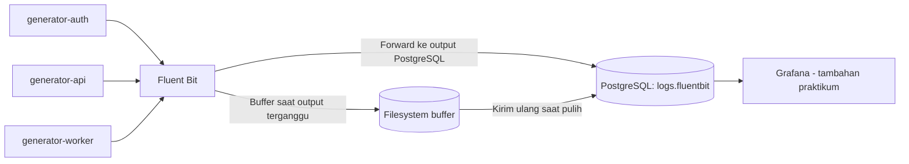

# Praktikum Bab 6 — Centralized Logging dengan Fluent Bit dan PostgreSQL

**Mata kuliah:** Workshop DevOps  
**Penyusun:** Kelompok 2 — D4 Lanjut Jenjang Teknik Informatika, PENS (2026)

[Lihat laporan lengkap (PDF)](Laporan.pdf) · [Kembali ke daftar laporan](../README.md)

## Gambaran umum

Bab 6 membangun sistem **centralized logging** untuk mengumpulkan event dari tiga generator (`generator-auth`, `generator-api`, dan `generator-worker`). Log dikirim melalui Docker logging driver ke **Fluent Bit**, kemudian disimpan pada **PostgreSQL** dalam bentuk JSONB. Laporan juga mencakup pengujian buffering saat database berhenti sementara dan pengembangan dashboard Grafana di luar langkah dasar cheatsheet.

## Arsitektur logging

Grafana membaca data melalui akun database dengan akses baca yang dibatasi; dashboard tersebut merupakan bagian **tambahan** dari praktikum, bukan bagian utama konfigurasi Fluent Bit.

## Langkah praktikum

1. Menyiapkan `.env.example`, `.gitignore`, dan Compose untuk PostgreSQL, Fluent Bit, serta tiga generator log.
2. Membuat inisialisasi PostgreSQL untuk schema dan tabel `logs.fluentbit`, indeks, view, dan user pengirim log dengan hak akses terbatas.
3. Mengonfigurasi Fluent Bit untuk menerima log dari Docker di port `24224`, memantau kesehatan di `2020`, serta mengirim log ke PostgreSQL dan output terminal.
4. Menggunakan `queries/analysis.sql` untuk menghitung log, mengelompokkan berdasarkan tag, mencari pesan error, dan mengamati tren waktu.
5. Menjalankan `scripts/generate-logs.sh` serta memeriksa kesiapan collector dan data yang tersimpan.
6. Menjalankan `scripts/test-buffering.sh` untuk menghentikan PostgreSQL sementara, menghasilkan log, memulihkan database, dan menguji pertambahan record.
7. Sebagai pengembangan, menghubungkan Grafana ke PostgreSQL dan membuat tampilan tabel log serta grafik time series.

## Indikator verifikasi

Laporan menyertakan delapan pemeriksaan: validasi konfigurasi Compose, kesehatan backend PostgreSQL, respons endpoint Fluent Bit, keberadaan tiga sumber log, kelengkapan field `container_name`/`source`/`log`, tipe kolom JSONB, pemulihan output setelah gangguan, dan pembatasan published port PostgreSQL.

| Komponen | Evidence yang digunakan |
|---|---|
| Docker Compose | `docker compose config --quiet` |
| PostgreSQL | Status healthcheck dan query jumlah record |
| Fluent Bit | Respons endpoint `/api/v1/health` |
| Data log | `GROUP BY tag`, pengecekan field dan `pg_typeof(data)` |
| Buffering | Perbandingan jumlah record sebelum dan setelah database pulih |
| Grafana | Koneksi data source PostgreSQL dan dashboard log |

## Hasil dan batasan

Laporan menunjukkan pengumpulan log dari tiga jenis generator, penyimpanan record berformat JSONB, dan pengujian untuk menilai apakah pengiriman dilanjutkan setelah PostgreSQL kembali aktif. **Pertambahan jumlah record saja tidak menjamin seluruh log selama gangguan telah diterima**; klaim tanpa kehilangan data perlu pemeriksaan kesesuaian event yang dikirim dan diterima.

## Kesimpulan

Fluent Bit digunakan sebagai collector terpusat sehingga log beberapa container dapat diperiksa dalam satu basis data. Penggunaan JSONB memudahkan analisis SQL, sedangkan buffering dan monitoring membantu evaluasi ketahanan ketika tujuan penyimpanan sementara tidak tersedia.

## Laporan dan referensi

- [Laporan praktikum Bab VI — Centralized Logging (PDF)](Laporan.pdf)
- [Materi DevSecOps](https://github.com/ferryas-pens/devsecops)

> **Keamanan:** port database tidak dipublikasikan ke host dalam rancangan dasar. Jangan mengunggah `.env`, password, atau dump data log yang bersifat sensitif.
