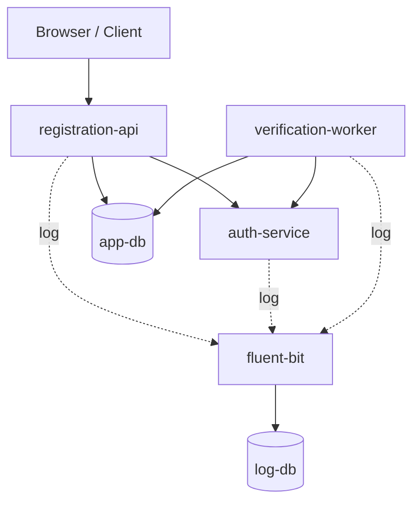

# Studi Kasus Bab 6 — Sistem Pendaftaran Mahasiswa Baru (PMB)

**Mata kuliah:** Workshop DevOps  
**Penyusun individu:** Ibram Maulana Akhsanul Qasasi (3126640014)  
**Program studi:** D4 Lanjut Jenjang Teknik Informatika — PENS (2026)

[Lihat laporan lengkap (PDF)](Laporan.pdf) · [Kembali ke daftar laporan](../README.md)

## Gambaran umum

Laporan ini mendokumentasikan uji coba aplikasi **Penerimaan Mahasiswa Baru (PMB)** pada **Ubuntu WSL 2** menggunakan Docker Compose. Pengujian tidak hanya memeriksa apakah halaman web berjalan, tetapi juga menilai proses bisnis pendaftaran, *retry* saat verifikasi terganggu, kemampuan pemulihan, dan keberlanjutan pencatatan log saat database logging dihentikan sementara.

## Arsitektur layanan

Enam service yang dilaporkan adalah `registration-api`, `auth-service`, `verification-worker`, `app-db`, `log-db`, dan `fluent-bit`.

Garis putus-putus menggambarkan jalur pengumpulan log. Diagram merupakan ringkasan hubungan layanan, bukan representasi detail setiap endpoint atau antrean internal.

## Persiapan dan troubleshooting

1. Menyiapkan utilitas dan mengekstrak arsip proyek PMB ke direktori praktikum di WSL.
2. Menjalankan skrip setup/validasi, yang mengonfirmasi enam service serta unit test dan konfigurasi Compose.
3. Pada percobaan awal, build tidak berhasil mengambil metadata `python:3.12-slim`; image kemudian diunduh secara manual dan proses build diulang.
4. Setelah container berjalan, endpoint belum dapat diakses dari host. Pemeriksaan port menunjukkan mapping yang diharapkan belum terpasang, lalu dibuat `compose.override.yaml` untuk menyesuaikan akses jaringan.
5. Karena akses port `8080` pada Windows tidak menuju aplikasi PMB yang dimaksud, akses situs dipindahkan ke `http://localhost:18080/register` untuk pengujian lokal.

## Empat tahap pengujian

| Tahap | Skenario | Hasil yang dilaporkan |
|---|---|---|
| **A — Baseline** | Insiden dinonaktifkan; mengirim pendaftaran normal | Transaksi berstatus `VERIFIED` pada percobaan pertama, dapat ditelusuri lewat `request_id` |
| **B — Failure Injection** | Mengaktifkan mode timeout pada proses verifikasi | Transaksi berakhir `FAILED` setelah 3 percobaan, dengan `failure_code = VERIFY-TIMEOUT` |
| **C — Recovery** | Menonaktifkan timeout, kemudian mengirim transaksi baru | Transaksi baru `VERIFIED`; transaksi lama yang `FAILED` tetap tercatat gagal |
| **D — Resilience Logging** | Menghentikan sementara `log-db`, tetap mengirim transaksi, lalu memulihkan database logging | Transaksi uji tetap `VERIFIED`; Fluent Bit menampung backlog di filesystem buffer dan mengirimkan log kembali setelah `log-db` pulih |

### Pengujian ketahanan logging

Pada Tahap D, laporan mencatat backlog buffer Fluent Bit mencapai **130 filesystem chunk** selama gangguan. Setelah database logging kembali tersedia, empat event transaksi yang diperiksa ditemukan masing-masing satu kali dan buffer pada pemeriksaan akhir kosong. Hasil ini mendukung keberhasilan pemulihan pada skenario pengujian tersebut, **bukan bukti umum exactly-once delivery** untuk semua kondisi.

## Evidence yang dicatat

- Status service dan pengujian endpoint kesehatan.
- Status transaksi dalam `app-db` serta kronologi event berdasarkan `request_id`.
- Perbandingan transaksi normal, gagal akibat timeout, dan berhasil setelah recovery.
- Metrik retry/output dan penyimpanan sementara Fluent Bit selama `log-db` berhenti.
- Pemeriksaan keberadaan secret, pengecualian `.env` oleh Git, dan checksum konfigurasi.

## Batasan

Pengujian dilakukan pada lingkungan WSL 2 dan skenario gangguan terkontrol. Laporan tidak mengklaim pengujian beban produksi, disk failure, hilang listrik, buffer penuh, maupun jaminan *exactly-once delivery* secara menyeluruh. Nilai kredensial laboratorium sengaja tidak disalin ke README ini.

## Kesimpulan

Praktikum menunjukkan hubungan antara kesehatan service, keberhasilan proses bisnis, dan observabilitas. Container yang masih berjalan tidak selalu berarti transaksi berhasil; perbedaan terlihat pada simulasi timeout. Pemisahan database transaksi dengan database log juga memungkinkan transaksi uji tetap berlangsung saat backend logging sementara tidak tersedia.

## Laporan dan referensi

- [Laporan praktikum studi kasus PMB (PDF)](Laporan.pdf)
- [Materi DevSecOps](https://github.com/ferryas-pens/devsecops)

> **Catatan publikasi:** tinjau tangkapan layar di PDF sebelum diunggah ke repository publik, terutama yang menampilkan konfigurasi, akun, password laboratorium, dan log.
