

# PRAKTIKUM UJI COBA PMB — DEVSECOPS BAB VI

**Mata kuliah:** Workshop DevOps  
**Praktikan:** Ibram Maulana Akhsanul Qasasi (3126640014)  
**Institusi:** Politeknik Elektronika Negeri Surabaya — 2026

## A. Persiapan lingkungan

### 1) Instalasi Utilitas

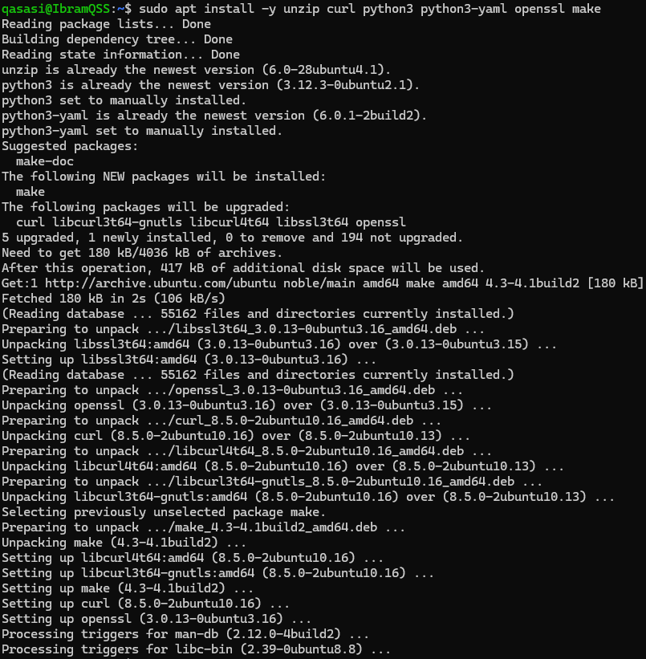

*Gambar 1 Instalasi utilitas praktikum di Ubuntu WSL*

Perintah pada Gambar 1 digunakan untuk memasang utilitas ekstraksi ZIP, pengujian HTTP, pemrosesan Python/YAML, pembuatan nilai acak, dan otomasi perintah. Opsi -y memberikan persetujuan otomatis ketika apt meminta konfirmasi. Hasil instalasi berhasil, sehingga kebutuhan awal skrip proyek tersedia.

### 2) Pemeriksaan direktori awal

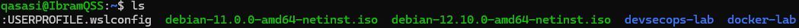

*Gambar 2 Daftar direktori awal di Ubuntu*

Perintah pada Gambar 2 menampilkan isi direktori saat itu. Hasilnya menunjukkan direktori docker-lab yang digunakan sebagai tempat penyimpanan beberapa praktikum Docker.

### 3) Pemeriksaan isi docker-lab

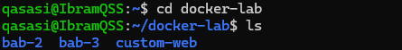

*Gambar 3 Isi direktori docker-lab sebelum penambahan Bab 6*

Perintah pada Gambar 3 digunakan untuk masuk ke direktori kerja dan melihat folder praktikum sebelumnya. Hasil yang ditemukan adalah bab-2, bab-3, dan custom-web, sehingga proyek baru dapat ditempatkan bersama proyek lama tanpa menghapusnya.

### 4) Menyalin ZIP dari Windows

*Gambar 4 Penyalinan ZIP PMB Bab 6 ke direktori kerja*

Perintah pada Gambar 4 menyalin arsip ZIP dari partisi Windows yang diakses melalui /mnt/c ke direktori docker-lab di WSL. Tanda titik di akhir perintah menunjuk lokasi saat ini. Perintah berhasil tanpa pesan kesalahan.

### 5) Pemeriksaan ZIP dan ekstraksi

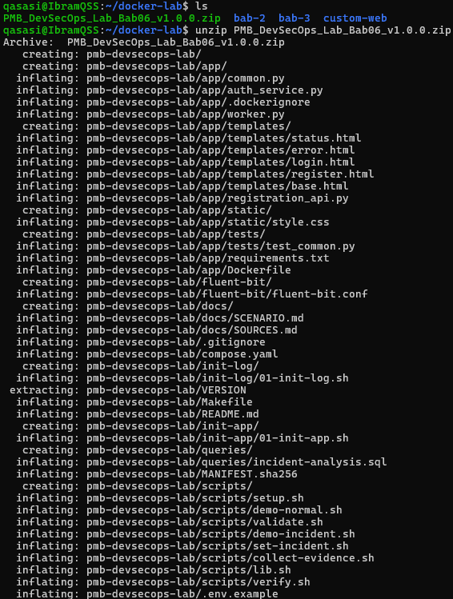

*Gambar 5 Arsip PMB berhasil ditemukan dan diekstrak*

Perintah pada Gambar 5 memastikan arsip tersedia bersama folder lama, lalu mengekstrak isinya. Output ekstraksi memperlihatkan folder pmb-devsecops-lab beserta file aplikasi, Docker Compose, Fluent Bit, SQL, dokumentasi, dan skrip praktikum.

### 6) Pemeriksaan struktur proyek

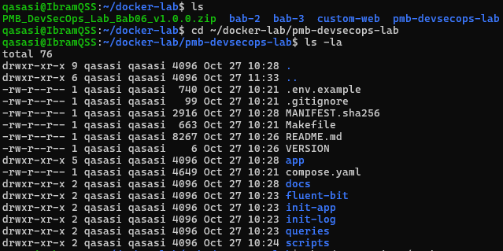

*Gambar 6 Struktur direktori pmb-devsecops-lab*

Perintah pada Gambar 6 memastikan folder hasil ekstraksi telah terbentuk kemudian menampilkan seluruh berkas proyek, termasuk berkas tersembunyi. Opsi -l menampilkan informasi rinci, sedangkan -a menyertakan berkas seperti .env.example dan .gitignore. File penting yang terlihat antara lain

compose.yaml, README.md, app, docs, fluent-bit, init-app, init-log, queries, dan scripts.

### 7) Setup dan validasi

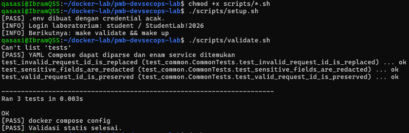

*Gambar 7 Persiapan .env dan hasil validasi proyek*

Perintah pada Gambar 7 memberikan izin eksekusi untuk skrip shell, menyiapkan konfigurasi .env dan memvalidasi proyek. Hasil setup menyatakan kredensial acak berhasil dibuat. Validasi memastikan enam service dikenali, tiga unit test lulus, dan Docker Compose valid. Pesan “Can't list 'tests'” tidak menggagalkan pemeriksaan karena unit test pada app/tests tetap dijalankan dengan hasil OK.

## B. Build container dan pemecahan gangguan jaringan

### 1) Percobaan build pertama

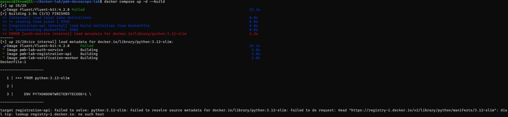

*Gambar 8 Build pertama gagal mengambil base image Python*

Perintah pada Gambar 8 digunakan untuk membangun image aplikasi dan menjalankan service berdasarkan Docker Compose. Opsi -d menjalankan service di latar belakang, sedangkan --build meminta pembangunan image aplikasi. Proses pertama gagal karena Docker tidak dapat melakukan lookup registry-1.docker.io ketika mengambil metadata python:3.12-slim.

### 2) Diagnosis DNS Docker Hub

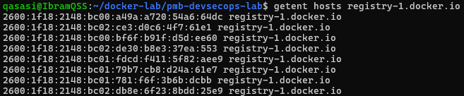

*Gambar 9 Hasil resolusi DNS registry Docker Hub*

Perintah pada Gambar 9 memeriksa apakah alamat Docker Hub bisa diterjemahkan menjadi alamat IP. Output menampilkan beberapa alamat IPv6, yang menunjukkan bahwa resolusi DNS dari Ubuntu WSL saat diperiksa sudah

berhasil; gangguan saat build kemungkinan bersifat sementara atau terjadi pada sisi Docker Engine.

### 3) Pengujian endpoint aplikasi sebelum berhasil berjalan

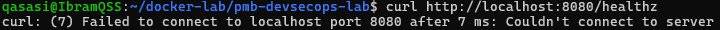

*Gambar 10 Endpoint PMB belum dapat diakses*

Perintah pada Gambar 10 mencoba mengakses endpoint kesehatan registration-api. Hasilnya gagal karena aplikasi belum berhasil berjalan dan/atau port host belum dapat diakses pada saat pengujian.

### 4) Pengunduhan base image secara manual

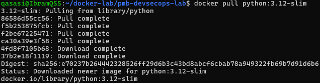

*Gambar 11 Image Python 3.12-slim berhasil diunduh*

Perintah pada Gambar 11 mengambil image dasar Python yang diperlukan oleh Dockerfile aplikasi. Hasilnya menunjukkan seluruh layer berhasil diunduh dan image python:3.12-slim tersedia secara lokal.

### 5) Build ulang dan pembuatan enam container

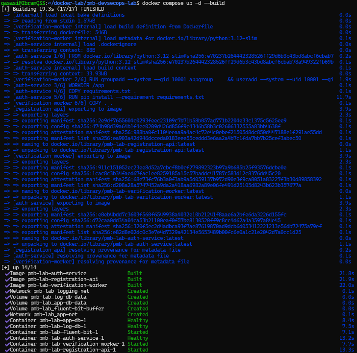

*Gambar 12 Build ulang aplikasi PMB berhasil*

Perintah pada Gambar 12 membangun ulang ketiga image aplikasi Python dan menyiapkan jaringan, volume, serta enam container. Hasilnya menunjukkan image pmb-lab-registration-api, pmb-lab-auth-service, dan pmb-lab-verification-worker berhasil dibangun dan service mulai dijalankan.

### 6) Pemeriksaan container

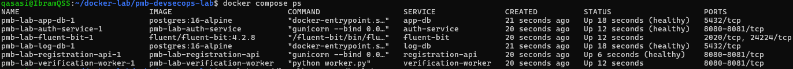

*Gambar 13 Status enam service setelah proses build*

Perintah pada Gambar 13 menunjukkan container app-db, auth-service, fluent-bit, log-db, registration-api, dan verification-worker. Database dan service yang memiliki healthcheck tampil healthy, tetapi pada saat ini kolom PORTS belum menunjukkan publikasi port registration-api dan Fluent Bit ke host.

### 7) Uji akses port sebelum perbaikan

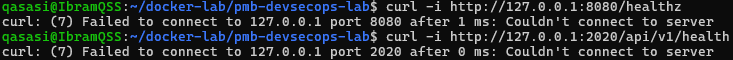

*Gambar 14 Koneksi ke registration-api dan Fluent Bit masih ditolak*

Perintah pada Gambar 14 mengirim permintaan HTTP ke endpoint kesehatan aplikasi dan collector serta meminta header respons ditampilkan melalui opsi -i. Kedua permintaan gagal tersambung, walaupun container berstatus berjalan, sehingga perlu memeriksa pemetaan port.

### 8) Pemeriksaan pemetaan port container

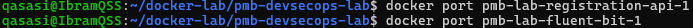

*Gambar 15 Tidak ditemukan pemetaan port yang dipublikasikan*

Perintah pada Gambar 15 memeriksa pemetaan port yang diterapkan pada dua container. Tidak ada output yang ditampilkan, menandakan tidak ada port host yang dipublikasikan pada saat itu. Kondisi tersebut menjelaskan kegagalan akses melalui curl.

## C. Perbaikan akses jaringan dan website PMB

### 1) Membuat Compose override

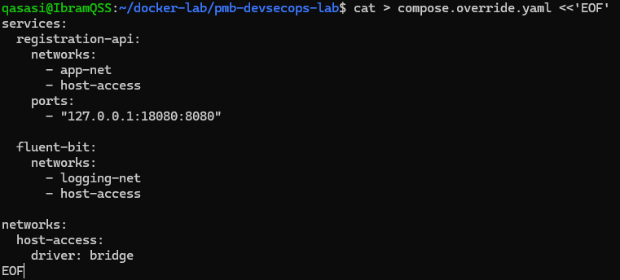

*Gambar 16 Membuat dan mengisi file compose.override.yaml*

Perintah tersebut membuat file compose.override.yaml tanpa mengubah compose.yaml bawaan dosen. Jaringan host-access ditambahkan pada registration-api dan Fluent Bit, sedangkan jaringan internal utama tetap dipakai. Perubahan ini ditujukan untuk memungkinkan publikasi port host pada lingkungan Docker WSL yang digunakan.

### 2) Validasi konfigurasi dan penerapan override

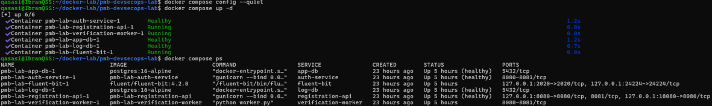

*Gambar 17 Pemetaan port berhasil setelah penambahan host-access*

Perintah konfigurasi memeriksa berkas Compose gabungan tanpa menampilkan output apabila valid; opsi --quiet adalah penulisan yang benar. Setelah perubahan diterapkan, kolom PORTS menunjukkan 127.0.0.1:8080->8080/tcp untuk registration-api serta port 2020 dan 24224 untuk Fluent Bit. Status ini dapat ditampilkan ulang dengan docker compose ps.

### 3) Uji kesehatan setelah perubahan jaringan

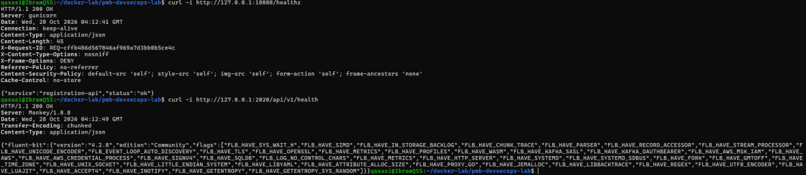

*Gambar 18 Kedua endpoint mengembalikan HTTP 200 OK*

Perintah di atas menguji ulang kedua endpoint. Hasil registration-api berupa HTTP 200 OK dengan JSON {"service":"registration-api","status":"ok"}, sedangkan Fluent Bit mengembalikan HTTP 200 OK beserta identitas versinya 4.2.8. Hal ini membuktikan akses host ke dua service sudah berfungsi.

### 4) Konflik port dengan Apache Windows

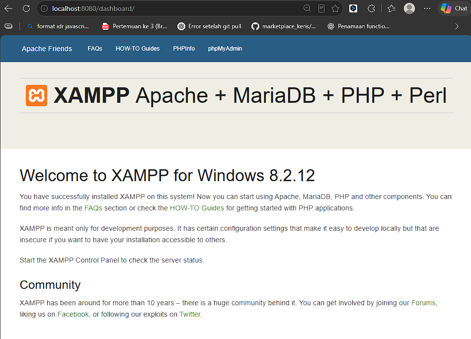

*Gambar 19 Tampilan pada browser ketika mengakses localhost:8080*

Ketika alamat http://localhost:8080 dibuka melalui browser Windows, halaman yang tampil justru Welcome to XAMPP.

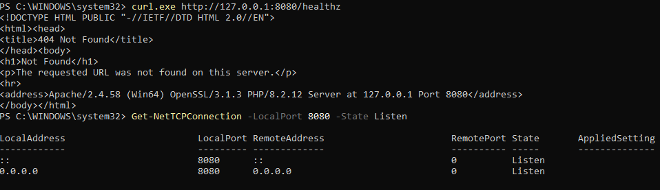

*Gambar 20 Pemeriksaan port 8080 pada powershell*

Pemeriksaan PowerShell memperlihatkan respons Apache/2.4.58 (Win64) dan proses PID 4800 yang mendengarkan port 8080. Dengan demikian, port 8080 pada Windows telah digunakan aplikasi lain dan tidak menunjuk website PMB.

### 5) Menambahkan port alternatif

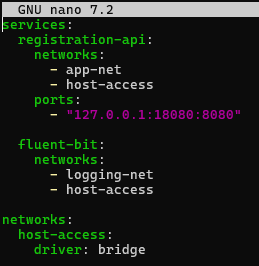

*Gambar 21 Menambahkan port*

Pengaturan port 18080 pada host diarahkan ke port 8080 di dalam container. Pengubahan dilakukan pada file override agar konfigurasi utama dari ZIP tetap dipertahankan. Port 18080 dipilih untuk menghindari benturan dengan Apache Windows.

### 6) Penerapan port alternatif

*Gambar 22 Menjalankan ulang command penerapan config*

Konfigurasi baru dinyatakan valid dan service diterapkan ulang. Hasil status container menunjukkan pemetaan tambahan 127.0.0.1:18080->8080/tcp pada registration-api sehingga website dapat diakses tanpa menghentikan Apache Windows.

### 7) Membuka portal PMB

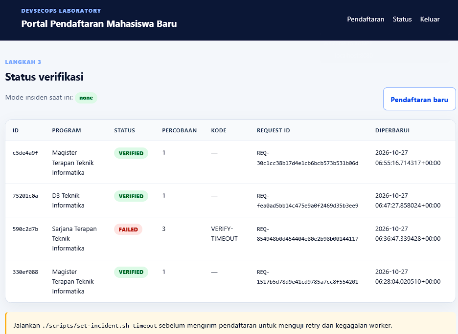

*Gambar 23 Website PMB berhasil dibuka dari browser Windows*

Setelah menggunakan port 18080, browser berhasil menampilkan portal Penerimaan Mahasiswa Baru. Website dapat digunakan untuk login, mengisi formulir, dan memeriksa status verifikasi. Alamat ini merupakan akses lokal praktikum, bukan website produksi.

## D. Tahap A — Baseline

### 1) Mengaktifkan mode normal

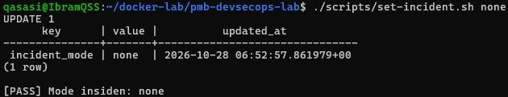

*Gambar 24 Mengaktifkan mode none*

Perintah pada Gambar 24 menjalankan skrip set-incident.sh dengan parameter none untuk menonaktifkan simulasi gangguan. Output UPDATE 1 dan [PASS] Mode insiden: none menunjukkan mode berhasil diterapkan sebelum pendaftaran normal dilakukan.

### 2) Mengisi dan mengirim formulir pendaftaran

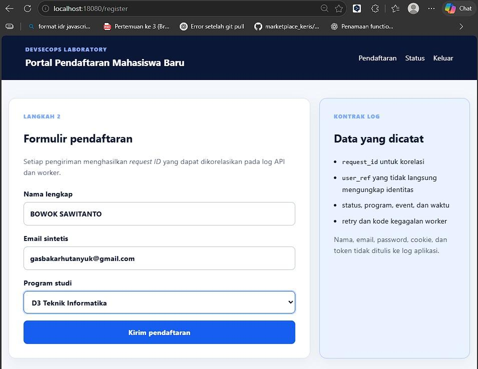

*Gambar 25 Mengisi formulir pendaftaran Baseline*

*Gambar 25 menunjukkan pengisian formulir PMB melalui localhost:18080/register. Data pendaftaran dikirim untuk memperoleh Request ID yang nantinya digunakan sebagai kunci korelasi antara database transaksi dan centralized log.*

### 3) Mengamati status sebelum dan sesudah verifikasi

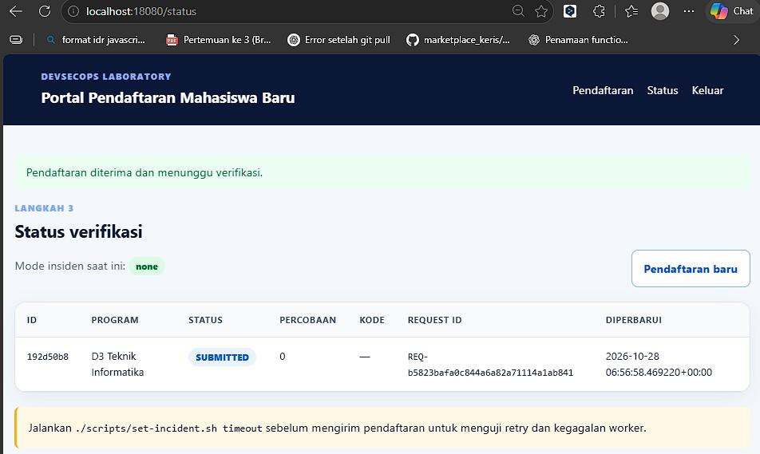

*Gambar 26 Status SUBMITTED sebelum pembaruan halaman*

*Gambar 26 memperlihatkan status awal SUBMITTED dengan percobaan 0. Kondisi tersebut menunjukkan transaksi telah diterima aplikasi, tetapi proses verifikasi oleh worker belum selesai pada saat halaman ditampilkan.*

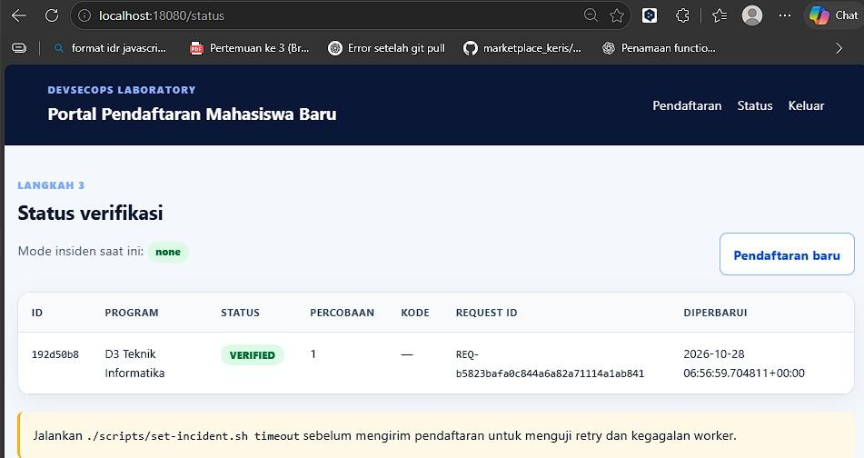

*Gambar 27 Status VERIFIED sesudah pembaruan halaman*

*Gambar 27 menunjukkan status transaksi berubah menjadi VERIFIED pada percobaan pertama tanpa kode kegagalan. Dengan demikian proses pendaftaran normal dapat diselesaikan oleh verification-worker.*

### 4) Memeriksa database transaksi dan Request ID

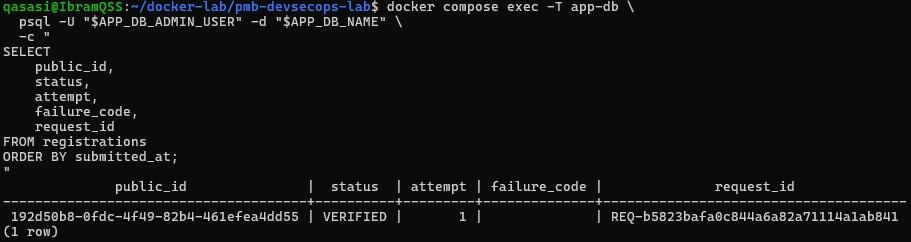

*Gambar 28 Pemeriksaan hasil transaksi pada app-db*

Perintah pada Gambar 28 mengambil public_id, status, attempt, failure_code, dan request_id dari tabel registrations. Hasil query memuat satu transaksi VERIFIED dengan attempt 1 dan Request ID REQ-b5823bafa0c844a6a82a71114a1ab841, yang dipakai untuk menelusuri log berikutnya.

### 5) Memeriksa centralized logging

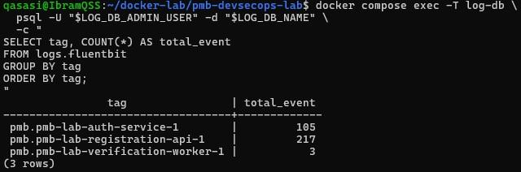

*Gambar 29 Jumlah log yang tersimpan menurut service*

Perintah pada Gambar 29 mengelompokkan record pada logs.fluentbit berdasarkan tag. Hasilnya mencatat 105 log auth-service, 217 log registration-api, dan 3 log verification-worker; angka total 325 mencakup log lain seperti healthcheck, bukan hanya transaksi pengujian.

### 6) Merekonstruksi kronologi event Baseline

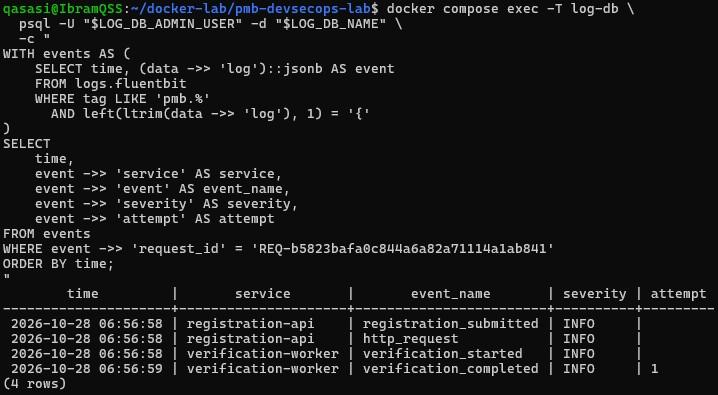

*Gambar 30 Kronologi event Baseline berdasarkan Request ID*

Perintah pada Gambar 30 menelusuri log terstruktur dengan Request ID Baseline. Ditemukan empat event berurutan: registration_submitted, http_request, verification_started, dan verification_completed; seluruhnya berlevel INFO. Timestamp tercatat pada rentang 06:56:58–06:56:59 UTC, sementara waktu pembaruan status menunjukkan selang sekitar 1,24 detik.

## E. Tahap B — Failure Injection

### 1) Mengaktifkan simulasi timeout

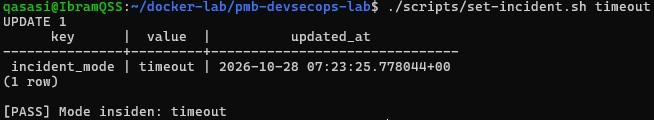

*Gambar 31 Mengubah mode insiden menjadi timeout*

Perintah pada Gambar 31 menjalankan set-incident.sh timeout. Hasil UPDATE 1 dan [PASS] Mode insiden: timeout membuktikan pengaturan gangguan aktif sehingga proses verifikasi berikutnya akan mengalami timeout yang disimulasikan.

### 2) Mengirim pendaftaran baru ketika gangguan aktif

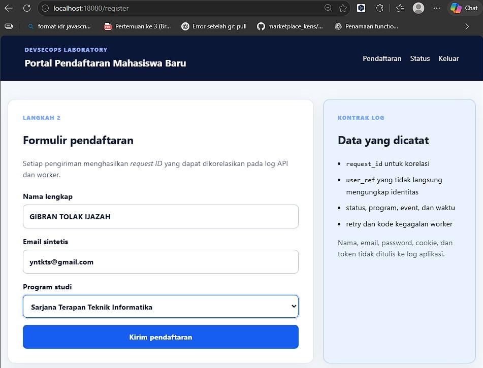

*Gambar 32 Formulir pendaftaran baru pada mode timeout*

*Gambar 32 menunjukkan formulir pendaftaran baru dengan data berbeda dari Tahap A. Pengujian memakai transaksi terpisah agar kronologi dan dampaknya dapat dibedakan dari pendaftaran normal.*

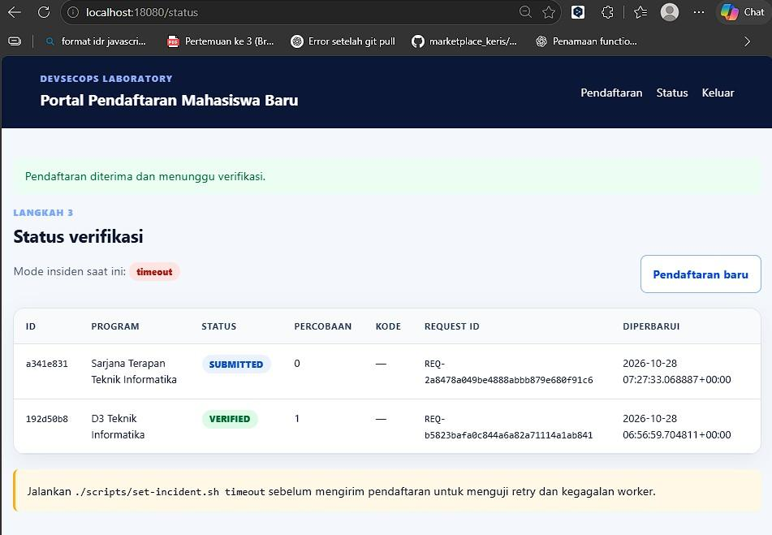

*Gambar 33 Status awal transaksi Failure Injection*

*Gambar 33 menunjukkan transaksi baru pada mode timeout masih berstatus SUBMITTED dan memiliki percobaan 0, sehingga kegagalan belum ditetapkan ketika halaman pertama kali ditampilkan.*

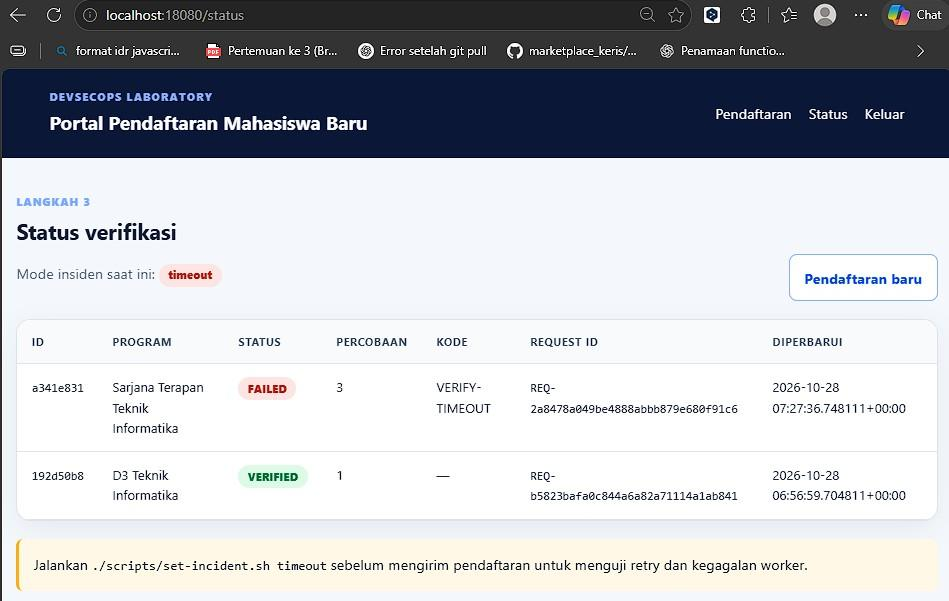

*Gambar 34 Status akhir FAILED setelah tiga percobaan*

*Gambar 34 memperlihatkan status akhir FAILED dengan jumlah percobaan 3 dan kode VERIFY-TIMEOUT. Sementara itu, transaksi Baseline tetap berada pada status VERIFIED.*

### 3) Membandingkan status melalui database transaksi

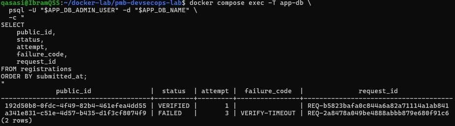

*Gambar 35 Database mencatat transaksi Baseline dan insiden*

Perintah pada Gambar 35 menampilkan status transaksi yang tersimpan di app-db. Terlihat transaksi Baseline VERIFIED attempt 1 dan transaksi insiden FAILED attempt 3 dengan failure_code VERIFY-TIMEOUT. Request ID insiden adalah REQ-2a8478a049be4888abbb879e680f91c6.

### 4) Menganalisis kronologi centralized log tanpa membaca kode aplikasi

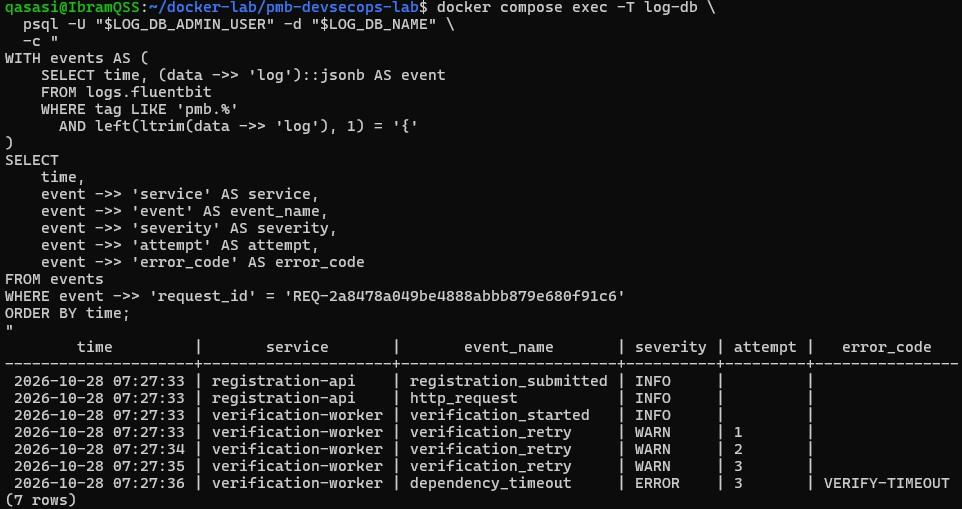

*Gambar 36 Urutan tujuh event selama insiden*

Perintah pada Gambar 36 mengambil event dari log-db menggunakan Request ID transaksi gagal. Terlihat urutan registration_submitted, http_request, verification_started, tiga verification_retry berlevel WARN (attempt 1–3), lalu dependency_timeout berlevel ERROR dengan kode VERIFY-TIMEOUT. Rentang timestamp sekitar 07:27:33–07:27:36 UTC.

### 5) Menentukan service pertama yang mencatat WARN atau ERROR

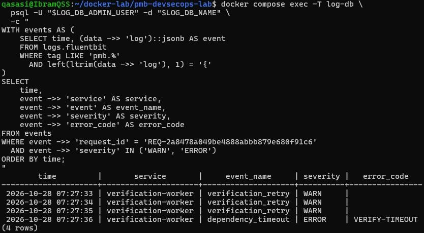

*Gambar 37 Identifikasi sumber peringatan dan kesalahan*

Perintah pada Gambar 37 menyaring severity WARN dan ERROR untuk transaksi insiden. Event WARN pertama berasal dari verification-worker pada verification_retry; service yang sama kemudian mencatat dependency_timeout berlevel ERROR. Hasil ini memperlihatkan bahwa gangguan terdeteksi di tahap verifikasi, bukan ketika registration-api menerima pendaftaran.

## F. Tahap C — Recovery

### 1) Mengembalikan mode insiden menjadi none

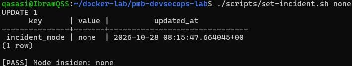

*Gambar 38 Menonaktifkan kembali simulasi timeout*

Perintah pada Gambar 38 mengembalikan incident_mode ke none melalui set-incident.sh. Output [PASS] Mode insiden: none menunjukkan bahwa pengujian selanjutnya menggunakan kondisi normal.

### 2) Mengirim transaksi baru dan mengamati status awal

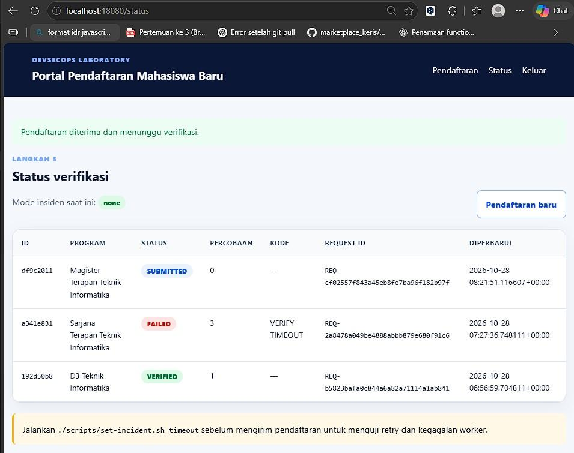

*Gambar 39 Transaksi baru masih berstatus SUBMITTED*

*Gambar 39 menunjukkan transaksi pemulihan telah diterima sebagai SUBMITTED dengan percobaan 0. Transaksi baru ini berbeda dari transaksi pada Tahap B yang sudah berstatus FAILED.*

### 3) Memastikan verifikasi baru berhasil

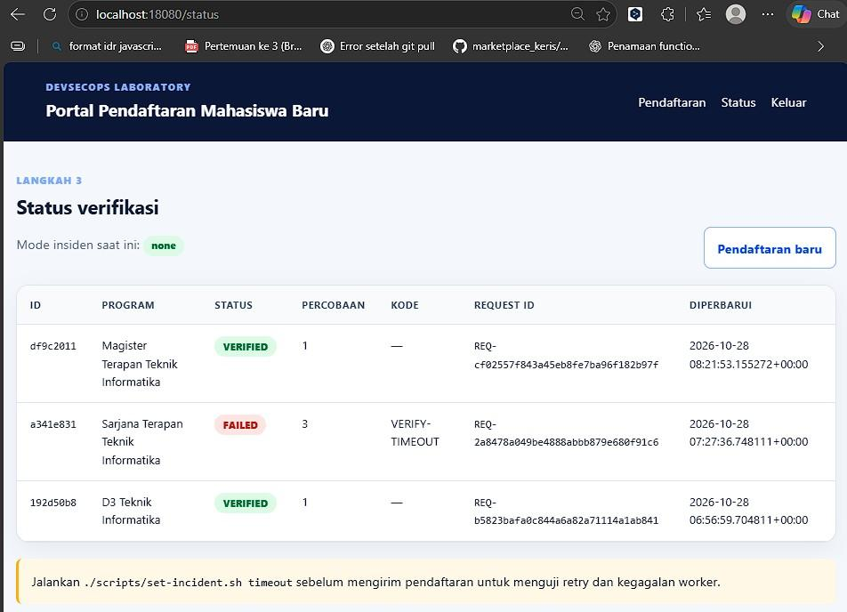

*Gambar 40 Transaksi baru VERIFIED tanpa mengubah status lama*

*Gambar 40 menunjukkan transaksi Recovery menjadi VERIFIED pada percobaan 1, sedangkan transaksi timeout sebelumnya tetap FAILED. Penonaktifan mode insiden memulihkan pemrosesan berikutnya, tetapi tidak otomatis menjadwalkan ulang transaksi yang telah mencapai status gagal.*

### 4) Membandingkan hasil ketiga transaksi

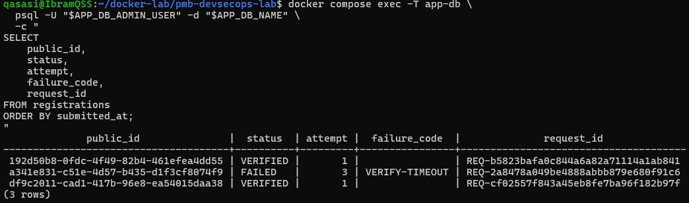

*Gambar 41 Perbandingan database Tahap A, B, dan C*

Perintah pada Gambar 41 menampilkan tiga transaksi: Baseline VERIFIED (1 percobaan), Failure Injection FAILED (3 percobaan, VERIFY-TIMEOUT), dan Recovery VERIFIED (1 percobaan). Hasil ini membuktikan keberhasilan pemulihan untuk transaksi baru tanpa mengubah histori transaksi lama.

### 5) Memeriksa kronologi event transaksi Recovery

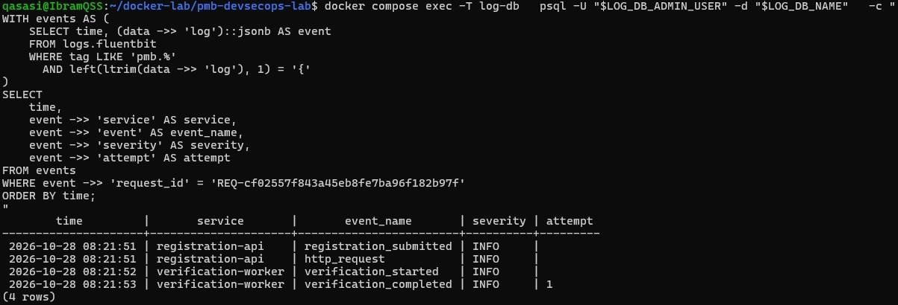

*Gambar 42 Empat event INFO setelah pemulihan*

Perintah pada Gambar 42 menyaring log berdasarkan Request ID Recovery REQ-cf02557f843a45eb8fe7ba96f182b97f. Tercatat registration_submitted, http_request, verification_started, dan verification_completed, seluruhnya INFO, tanpa verification_retry maupun dependency_timeout. Transaksi lama tidak otomatis berubah dari FAILED karena perubahan incident_mode hanya memengaruhi kondisi pemrosesan berikutnya; sistem tidak menjalankan ulang pekerjaan yang telah mencapai status gagal. Untuk produksi, transaksi gagal sementara dapat diproses ulang secara terkontrol dengan batas percobaan, exponential backoff, dan idempotensi. Transaksi yang tetap gagal setelah batas retry dapat dipindahkan ke dead-letter queue untuk ditinjau serta diproses ulang oleh operator. Strategi tersebut merupakan usulan, bukan fitur yang telah diterapkan dalam praktikum.

## G. Tahap D — Resilience Logging

### 1) Mencadangkan dan menyesuaikan konfigurasi Fluent Bit

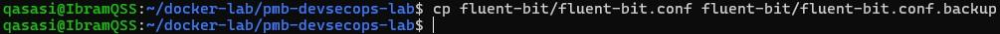

*Gambar 43 Membuat cadangan fluent-bit.conf*

Perintah pada Gambar 43 menyalin file fluent-bit.conf menjadi fluent-bit.conf.backup sehingga konfigurasi awal dapat dipulihkan apabila perubahan retry dan buffering menimbulkan masalah.

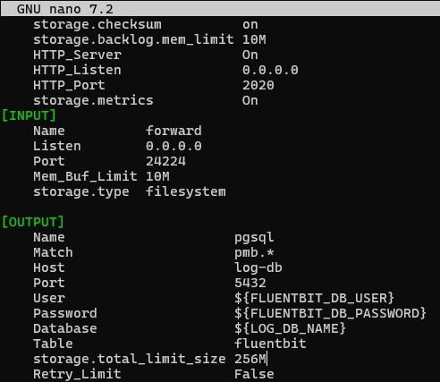

*Gambar 44 Menambahkan storage metrics dan kebijakan retry*

*Gambar 44 memperlihatkan konfigurasi Fluent Bit yang memakai filesystem storage dan batas antrean output 256M. Pengaturan storage.metrics On digunakan untuk memantau buffer, sedangkan Retry_Limit False mempertahankan upaya pengiriman ulang selama chunk masih tersedia dan kapasitas penyimpanan mencukupi.*

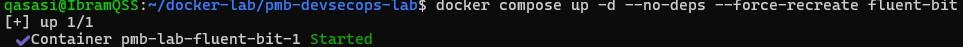

*Gambar 45 Menjalankan ulang container Fluent Bit*

Perintah pada Gambar 45 menerapkan konfigurasi baru melalui docker compose up -d --no-deps --force-recreate fluent-bit. Hasilnya container Fluent Bit berhasil di-recreate dan dijalankan tanpa mengulang seluruh service lainnya.

### 2) Memastikan collector dan endpoint metrik tersedia

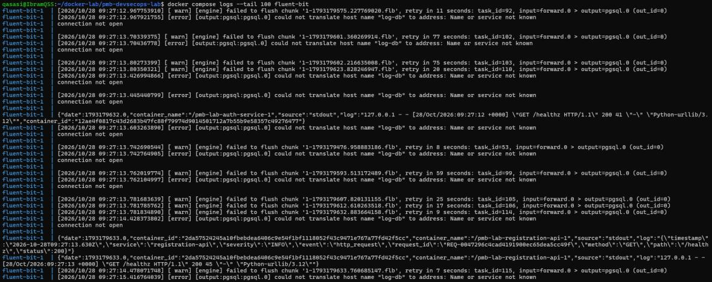

*Gambar 46 Memeriksa aktivitas container Fluent Bit*

Perintah pada Gambar 46 digunakan untuk memeriksa log container Fluent Bit yang sedang berjalan. Keluaran menjadi dasar pemeriksaan aktivitas output PostgreSQL serta potensi error atau retry ketika database nanti dihentikan.

*Gambar 47 Memeriksa endpoint storage sebelum gangguan*

Perintah pada Gambar 47 mengakses endpoint HTTP /api/v1/storage melalui port 2020. Nilai total_chunks 0 menunjukkan tidak terdapat antrean aktif pada saat pemeriksaan awal, sekaligus membuktikan endpoint metrik dapat diakses.

### 3) Mencatat jumlah log sebelum database dihentikan

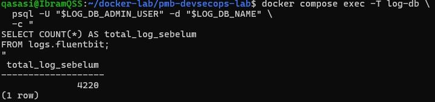

*Gambar 48 Jumlah log awal pada database log*

Perintah pada Gambar 48 menghitung seluruh record pada tabel logs.fluentbit sebelum simulasi gangguan. Nilai awal yang diperoleh adalah 4.220 record, untuk dibandingkan dengan kondisi setelah pemulihan.

### 4) Menghentikan log-db sementara

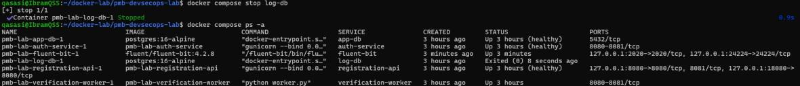

*Gambar 49 Menghentikan backend centralized logging*

Perintah pada Gambar 49 menghentikan log-db lalu memeriksa status seluruh container. Hasilnya log-db berstatus Exited, sementara database aplikasi, API, authentication service, verification-worker, dan Fluent Bit tetap berjalan sehingga transaksi masih dapat diproses.

### 5) Mengirim transaksi ketika log-db tidak tersedia

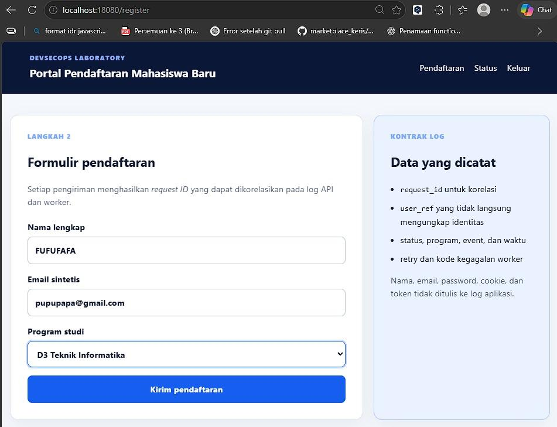

*Gambar 50 Formulir pendaftaran pada saat log-db berhenti*

*Gambar 50 menunjukkan transaksi pendaftaran baru dibuat ketika log-db sedang tidak tersedia. Pengujian ini memisahkan keberhasilan fungsi bisnis dari ketersediaan database log.*

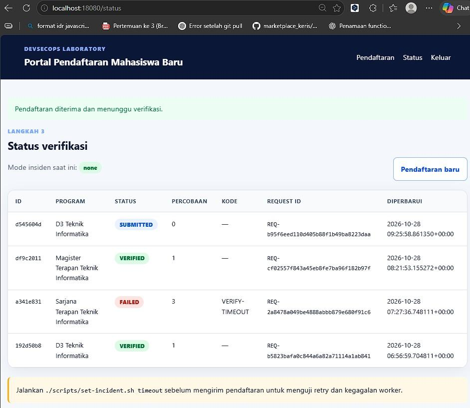

*Gambar 51 Status awal SUBMITTED ketika log-db berhenti*

*Gambar 51 memperlihatkan transaksi baru masih SUBMITTED. Walaupun database log dimatikan, registration-api tetap dapat menerima transaksi pada app-db.*

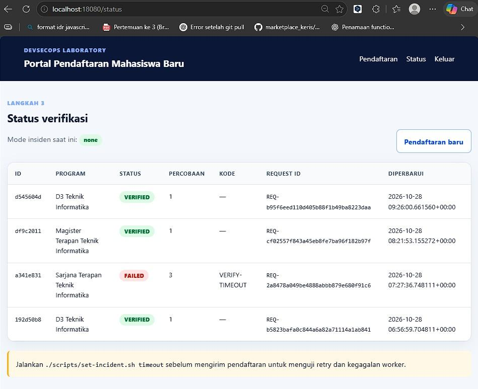

*Gambar 52 Status VERIFIED meskipun log-db tidak tersedia*

*Gambar 52 menunjukkan transaksi baru menjadi VERIFIED pada percobaan 1, sementara mode insiden tetap none. Ini membuktikan bahwa kegagalan backend logging tidak langsung menghentikan proses bisnis pendaftaran.*

### 6) Mengamati retry dan penggunaan buffer saat gangguan

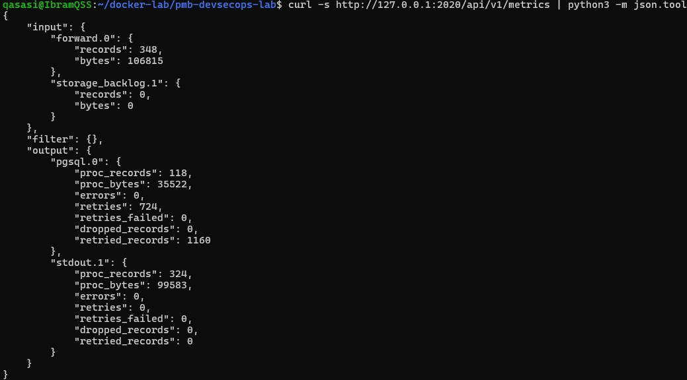

*Gambar 53 Metrik retry Fluent Bit selama gangguan*

Perintah pada Gambar 53 membaca /api/v1/metrics. Output pgsql mencatat 724 retries, 0 retries_failed, dan 0 dropped_records pada pengamatan tersebut. Metrik ini bersifat kumulatif selama proses Fluent Bit aktif.

*Gambar 54 Buffer filesystem menampung 130 chunk*

Perintah pada Gambar 54 membaca /api/v1/storage ketika backend logging berhenti. Tercatat 130 filesystem chunk, 128 chunk up, dan 2 chunk down; data belum dapat seluruhnya dikirim ke PostgreSQL sehingga ditampung sementara.

### 7) Menjalankan kembali log-db

*Gambar 55 Memulihkan backend log-db*

Perintah pada Gambar 55 menjalankan kembali log-db kemudian memeriksa status container. Hasilnya log-db kembali Up dan healthy, sehingga Fluent Bit dapat mencoba mengirim chunk yang tertunda.

### 8) Memeriksa pertambahan record dan kondisi awal setelah pemulihan

*Gambar 56 Jumlah log setelah database kembali aktif*

Perintah pada Gambar 56 mencatat 5.302 record setelah pemulihan, bertambah

## 1.082 dari sebelum gangguan. Pertambahan ini sendiri belum membuktikan seluruh backlog terkirim, karena log healthcheck dan aktivitas lain juga ikut bertambah.

*Gambar 57 Pemeriksaan pertama log transaksi Tahap D*

Perintah pada Gambar 57 menelusuri Request ID REQ-b95f6eed110d405b88f1b49ba8223daa ketika database baru dipulihkan. Hasil awal 0 rows menunjukkan keempat event belum langsung ditemukan, sehingga pengiriman backlog perlu diperiksa lebih lanjut.

*Gambar 58 Buffer masih berisi 80 filesystem chunk*

*Gambar 58 memperlihatkan buffer belum kosong setelah log-db aktif kembali: tercatat 80 filesystem chunk. Ini menunjukkan masih ada antrean yang belum selesai diproses oleh output PostgreSQL.*

*Gambar 59 Metrik pengiriman setelah log-db aktif*

Perintah pada Gambar 59 menunjukkan proc_records output pgsql telah meningkat menjadi 1.524, retries 1.290, retries_failed 0 dan dropped_records 0. Hasil ini menunjukkan pemrosesan log berlanjut tanpa pembuangan record yang dilaporkan dalam snapshot tersebut.

### 9) Menelusuri event yang masuk bertahap

*Gambar 60 Event verification_completed ditemukan pertama kali*

Perintah pada Gambar 60 mencari Request ID secara langsung melalui LIKE di kolom pesan log. Hasil query menemukan satu event verification_completed dari verification-worker, sedangkan event lain belum ditemukan saat pemeriksaan tersebut.

*Gambar 61 Buffer berkurang menjadi 80 chunk aktif*

*Gambar 61 menunjukkan pemeriksaan filesystem buffer pada tahap pengiriman ulang. Nilai total_chunks 80 menandakan backlog belum habis walaupun database sudah pulih.*

*Gambar 62 Jumlah record diproses output meningkat*

*Gambar 62 memperlihatkan metrik output PostgreSQL saat pemulihan berlangsung. Jumlah proc_records meningkat dan dropped_records tetap nol sehingga pengiriman sedang berproses, meskipun kelengkapan transaksi tetap harus diperiksa berdasarkan Request ID.*

*Gambar 63 Bukti collector menerima empat event transaksi*

Perintah pada Gambar 63 mencari Request ID pada stdout Fluent Bit. Keempat event registration_submitted, http_request, verification_started, dan verification_completed berhasil ditemukan di sisi collector. Dengan demikian setiap event telah mencapai Fluent Bit sebelum diperiksa kelengkapannya di database.

*Gambar 64 Jumlah filesystem chunk turun menjadi 53*

*Gambar 64 menunjukkan buffer filesystem kembali berkurang hingga 53 chunk. Penurunan ini konsisten dengan proses pengosongan antrean sesudah pemulihan database.*

*Gambar 65 Record berhasil diproses bertambah*

*Gambar 65 menunjukkan proc_records output PostgreSQL meningkat menjadi 1.711, sedangkan retry tetap 1.290 dan dropped_records 0. Snapshot ini memperkuat bukti bahwa proses pengiriman kembali berjalan.*

### 10) Memeriksa hasil awal sebagian backlog dan pesan keberhasilan retry

*Gambar 66 Tiga event transaksi terdeteksi di log-db*

Perintah pada Gambar 66 mengelompokkan event berdasarkan jenisnya. Tiga event ditemukan masing-masing satu kali; verification_started belum ada pada pemeriksaan tersebut, sehingga pemulihan seluruh log transaksi belum bisa dinyatakan lengkap.

*Gambar 67 Pemeriksaan kronologi saat baru tiga event tersimpan*

*Gambar 67 menampilkan kronologi dari log-db berdasarkan Request ID. Tiga event yang sudah tersimpan adalah registration_submitted, http_request, dan verification_completed; urutan verifikasi belum lengkap karena verification_started belum muncul.*

*Gambar 68 Bukti chunk berhasil di-flush setelah retry*

Perintah pada Gambar 68 memeriksa log Fluent Bit dan menampilkan pesan flush chunk succeeded at retry 9 hingga retry 11. Pesan ini merupakan bukti langsung bahwa sejumlah chunk yang sebelumnya gagal dikirim akhirnya berhasil diproses setelah database aktif kembali.

### 11) Melanjutkan pemantauan hingga empat event berhasil tersimpan

*Gambar 69 Pemeriksaan ketika 29 chunk masih tersisa*

Perintah pada Gambar 69 menunjukkan filesystem buffer masih memiliki 29 chunk dan nilai busy juga 29. Kondisi tersebut berarti antrean belum selesai sepenuhnya walaupun event transaksi terus diperiksa.

*Gambar 70 Keempat event transaksi akhirnya tersimpan*

Perintah pada Gambar 70 menyatukan daftar event yang diharapkan dengan log aktual dan menghitung masing-masing record. Hasilnya keempat event registration_submitted, http_request, verification_started, dan verification_completed masing-masing berjumlah 1. Bukti ini menunjukkan pemulihan backlog berhasil untuk seluruh event transaksi uji tersebut.

*Gambar 71 Buffer collector telah kosong*

Perintah pada Gambar 71 memeriksa kembali endpoint storage setelah proses retry. Screenshot menunjukkan total_chunks 0 dan fs_chunks 0, yang berarti tidak ada chunk aktif di buffer pada saat pemeriksaan terakhir. Hasil Tahap D membuktikan bahwa Fluent Bit dapat menampung event pada filesystem buffer ketika PostgreSQL berhenti dan mengirimkan ulang backlog setelah database pulih. Pada saat gangguan buffer mencapai 130 chunk dan metrik mencatat retry, sedangkan setelah pemulihan empat dari empat event transaksi uji ditemukan satu kali dan buffer pada pemeriksaan akhir kosong. Hasil tersebut tidak membuktikan exactly-once delivery secara umum: jika database sudah menyimpan batch tetapi konfirmasi ke Fluent Bit terputus, retry berpotensi menyimpan duplikat; saat storage.total_limit_size 256M terlampaui, chunk tertua pun dapat dibuang. Perlu event_id unik, deduplikasi, dan pemantauan kehilangan atau duplikasi untuk jaminan lebih kuat.

## H. Pertanyaan Analitis

1) Mengapa status container Up tidak membuktikan fungsi bisnis sehat? Status Up hanya menunjukkan proses utama container masih berjalan, bukan bahwa alur bisnis bekerja benar. Pada Tahap B, container aplikasi tetap aktif tetapi transaksi berakhir FAILED akibat VERIFY-TIMEOUT. Kesehatan bisnis perlu diuji melalui endpoint, log error, status pada database transaksi, dan hasil verifikasi end-to-end.

2) Apa perbedaan event time, waktu penerimaan collector, dan waktu penyimpanan database? Event time adalah waktu kejadian di aplikasi yang tercatat pada field timestamp dalam JSON. Waktu penerimaan collector adalah saat Fluent Bit mendapatkan record melalui input forward; output stdout memuat field date. Waktu penyimpanan database adalah saat record benar-benar disimpan PostgreSQL. Perbedaannya dapat besar ketika terjadi buffering dan retry; tabel lab tidak mempunyai kolom khusus waktu INSERT sehingga waktu penyimpanan tepatnya tidak dapat dipastikan dari field time saja.

3) Mengapa nama dan email tidak dimasukkan ke structured log? Nama dan email adalah data pribadi yang tidak diperlukan untuk penelusuran teknis setiap transaksi. Pencatatan keduanya memperbesar risiko kebocoran melalui sistem log, akses operator, dan arsip. Korelasi cukup memakai request_id, user_ref, service, event, timestamp, status, serta error_code; data identitas sebaiknya hanya tersimpan pada database transaksi dengan akses terbatas.

4) Apa risiko penggunaan request_id dari client tanpa validasi? Client dapat mengirim ID palsu, memakai ID transaksi lain, atau memasukkan karakter kontrol dan string terlalu panjang sehingga memicu pencemaran log, salah korelasi, dan kesulitan investigasi. Server perlu menerapkan batas panjang, validasi format, normalisasi yang aman, dan pembuatan ID tepercaya pada boundary aplikasi; request_id bukan bukti identitas maupun otorisasi.

5) Apa yang terjadi bila buffer Fluent Bit mencapai batas 256 MB? Dalam konfigurasi output pgsql digunakan storage.total_limit_size 256M. Ketika batas antrean output tercapai, Fluent Bit dapat membuang chunk tertua untuk menyediakan ruang bagi chunk baru, sehingga peristiwa lama berisiko hilang meskipun Retry_Limit False diaktifkan. Pengujian ini tidak menguji buffer sampai penuh; kondisi tersebut memerlukan pemantauan kapasitas, alert, dan uji beban terpisah.

6) Bagaimana mendeteksi duplikasi record setelah retry? Untuk transaksi tertentu, periksa GROUP BY request_id, service, event, timestamp, dan attempt lalu cari COUNT(*) lebih dari satu. Pada Tahap D, empat jenis event yang diharapkan masing-masing ditemukan satu kali, tetapi itu bukan jaminan umum. Sistem produksi lebih baik menambahkan event_id yang unik dan mengaktifkan deduplikasi atau constraint unik yang sesuai di penyimpanan.

7) Kapan PostgreSQL tidak lagi sesuai sebagai backend log utama? PostgreSQL memadai pada skala lab atau beban terbatas yang membutuhkan SQL dan korelasi sederhana. Jika ingest log sangat tinggi, retensi panjang, volume data besar, pencarian full-text lintas layanan intensif, atau butuh distribusi lintas node dengan latensi rendah, biaya partisi, indeks, dan pemeliharaan dapat menjadi penghambat. Saat itu perlu menilai platform logging khusus berdasarkan beban nyata dan kebutuhan pencarian.

8) Kontrol apa yang harus ditambahkan sebelum arsitektur serupa dipakai pada produksi? Diperlukan TLS/mTLS antarkomponen, manajemen dan rotasi secret, RBAC, pembatasan jaringan, hardening container, audit akses, enkripsi data, kebijakan retensi dan penghapusan PII, validasi request_id, rate limit, pencatatan event_id, idempotensi dan deduplikasi, backup dan disaster recovery, pemantauan retries_failed/dropped_records/konsumsi buffer, alert, dan pengujian beban serta failure scenario yang terukur. I. Evidence Minimum

1) Status service Bukti: Gambar 49 (log-db Exited sedangkan service lain Up) dan Gambar 55 (log-db kembali healthy). Status Up perlu dilengkapi pemeriksaan kesehatan fungsi bisnis.

2) Request ID Baseline dan insiden Baseline: REQ-b5823bafa0c844a6a82a71114a1ab841. Insiden: REQ-2a8478a049be4888abbb879e680f91c6. Request ID Recovery: REQ-cf02557f843a45eb8fe7ba96f182b97f. Request ID Resilience: REQ-b95f6eed110d405b88f1b49ba8223daa.

3) Query kronologi kedua Request ID Gambar 30 memperlihatkan empat event INFO pada Baseline, sedangkan Gambar 36 menampilkan tujuh event pada insiden: tiga verification_retry (WARN) dan dependency_timeout (ERROR).

4) Jumlah retry dan kode kegagalan Transaksi insiden menggunakan 3 percobaan dengan failure_code VERIFY-TIMEOUT (Gambar 34–37). Metrik output Fluent Bit sempat menunjukkan 724 kemudian 1.290 retry, dengan retries_failed dan dropped_records 0 pada snapshot pengujian (Gambar 53 dan 59).

5) Bukti recovery transaksi baru Gambar 38–42 menunjukkan transaksi Recovery baru berakhir VERIFIED pada percobaan 1, sementara transaksi lama dari Failure Injection tetap FAILED.

### 6) Hasil pemeriksaan secret

*Gambar 72 Cek secret Perintah pada Gambar 72 digunakan untuk memeriksa keamanan informasi sensitif pada konfigurasi dan centralized logging aplikasi PMB. Hasilnya menunjukkan bahwa file .env hanya dapat diakses oleh pemiliknya dan lima*

variabel sensitif telah terisi tanpa menampilkan nilai aslinya. Pemeriksaan pada PostgreSQL tidak menemukan field sensitif sesuai pola pencarian dalam log, sedangkan pemeriksaan .gitignore menunjukkan bahwa file .env telah dikecualikan dari Git. Hasil ini menunjukkan bahwa perlindungan dasar terhadap informasi sensitif telah diterapkan, meskipun belum menjamin seluruh kemungkinan kebocoran data dapat dicegah.

### 7) Checksum konfigurasi

*Gambar 73 Cheksum*

Perintah pada Gambar 73 digunakan untuk menghasilkan checksum SHA-256 dari file konfigurasi Docker Compose dan Fluent Bit. Hasilnya menunjukkan bahwa ketiga file berhasil diperiksa dan masing-masing memiliki nilai checksum yang dapat digunakan sebagai acuan untuk mendeteksi perubahan konfigurasi. Jika isi file mengalami perubahan, nilai checksum yang dihasilkan akan berbeda.

8) Pernyataan keterbatasan pengujian Pengujian hanya pada WSL 2 dengan Docker Compose dalam skenario buatan. Keempat event pada satu transaksi Tahap D ditemukan masing-masing sekali, tetapi tidak dilakukan uji buffer penuh 256 MB, beban besar, kehilangan listrik, ketahanan disk, maupun pembuktian exactly-once delivery untuk seluruh event.

---

[Kembali ke daftar laporan](../README.md)
